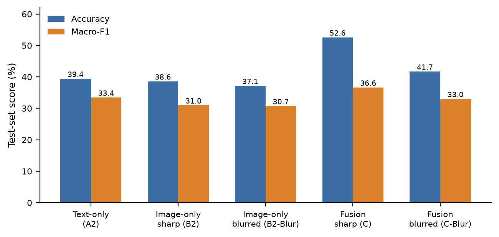
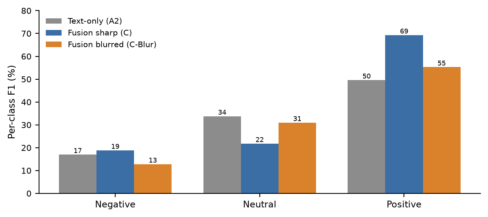

# Embedded-Text Leakage in Multimodal Meme Sentiment Classification: A Resource-Constrained Study of When Fusion Really Helps

**Authors:** Kartikey Tiwari, Akshat Sharma, Karan Sharma, Lalit Sharma
**Affiliation:** Department of Computer Science and Engineering, Ajay Kumar Garg Engineering College, Ghaziabad (Dr. A.P.J. Abdul Kalam Technical University, Lucknow)
**Supervisor:** Dr. Avdhesh Gupta

## Abstract

Prior controlled comparisons of text-only, image-only, and multimodal (text+image)
sentiment classification on social media report that fusion helps because text and
images carry genuinely complementary signal. Those studies use photographic images
(e.g., tweet photos), where the image and the caption are produced independently.
Internet memes break that independence: meme text is typically rendered as pixels
directly on the image, so an "image-only" model can, in principle, re-derive the same
text signal the "text-only" model already sees. This paper asks whether multimodal
fusion gains reported for photographic social-media images still hold for memes, and
how much of any such gain is attributable to this embedded-text channel rather than
genuine cross-modal (visual) information. We run a controlled, same-split,
same-metrics comparison on a stratified 3,500-sample subset (2,800/350/350
train/val/test, class-balance-preserving) of the public Memotion dataset (SemEval-2020
Task 8; accessed via a Hugging Face mirror, 6,992 memes total), collapsing its 5-class
sentiment to 3 classes (positive/neutral/negative). We evaluate TF-IDF+LogisticRegression
and frozen-DistilBERT text models, a from-scratch CNN and a frozen-ResNet18 image model,
and a feature-concatenation fusion MLP -- each trained and evaluated twice: once on the
original ("sharp") memes, and once on the same memes after a strong Gaussian blur that
destroys fine (text-scale) pixel detail while preserving coarse colour and composition
(objectively confirmed via a 99.9% drop in mean Laplacian-variance image sharpness on a
150-image sample). On sharp images, fusion reaches 52.6% test accuracy / 36.6% macro-F1,
clearly ahead of the best unimodal model (TF-IDF text: 42.6% accuracy; frozen DistilBERT
text: 33.4% macro-F1). Blurring barely changes the image-only model (-1.4pp accuracy,
-0.2pp macro-F1), but collapses most of the fusion gain (-10.9pp accuracy, -3.6pp
macro-F1): the blurred-image fusion model performs statistically indistinguishably from
text-only (+2.3pp accuracy, -0.4pp macro-F1 relative to text-only). This indicates that,
for this meme dataset, the fusion benefit is substantially mediated by the image
channel's access to legible embedded text rather than by independent visual sentiment
cues -- a finding with direct implications for any system that assumes "image" and
"text" are independent evidence sources when the images in question may themselves
contain the text. All experiments ran on constrained consumer CPU hardware (no GPU,
8GB RAM), consistent with a broader resource-constrained reproducibility aim in this
research area.

**Keywords:** Multimodal Sentiment Analysis, Internet Memes, Social Media Analytics,
Feature Fusion, DistilBERT, ResNet18, Embedded Text, Modality Leakage,
Resource-Constrained Machine Learning

## 1. Introduction

Multimodal sentiment analysis on social media typically assumes text and image are two
independently produced evidence sources whose combination can only help, or at worst
add noise, precisely because they are independent. That assumption is reasonable for a
tweet consisting of a caption plus an attached photograph. It is not obviously
reasonable for an Internet meme, where the "image" frequently *is* the text: bold
caption text is rendered directly onto the picture, typically in a small number of
recognizable templates. A convolutional image encoder operating on raw pixels does not
know, a priori, that a region of high-contrast, high-frequency pixels is text rather
than visual texture -- it may simply learn to exploit it, whether or not that was the
intended "visual" signal.

This paper investigates that possibility directly. We ask two questions: (RQ1) does
multimodal fusion still outperform unimodal text and image baselines for meme sentiment
classification, replicating the pattern reported for photographic social-media images;
and (RQ2) how much of any such fusion gain depends specifically on the image channel's
ability to read embedded text from pixels, as opposed to independent visual
(compositional, colour, facial-expression) sentiment cues? We answer RQ2 with a direct
ablation: we destroy legible text-scale detail with a strong, objectively validated
Gaussian blur, re-extract image features, and re-train every image-dependent model,
holding everything else (data, split, text features, architecture, training procedure)
fixed.

## 2. Related Work

Controlled text-vs-image-vs-multimodal comparisons on real social-media data are rare;
the closest located prior work evaluates a social-media condition on photographic
Twitter images and reports that fusion helps specifically on the subset of posts where
text and image models disagree, with a small regression where they already agree.
Multimodal fusion more broadly has a mature taxonomy and survey literature [1], [2].
Memes specifically have been studied as a distinct multimodal object: the Memotion /
SemEval-2020 Task 8 dataset used here was introduced explicitly to study sentiment,
humor, sarcasm, offensiveness, and motivational content in memes as combined
text-image artifacts [3], and the Hateful Memes Challenge [4] was explicitly motivated
by the observation that meme meaning often depends on a text-image interaction that
neither modality alone captures -- but, to our knowledge, neither line of work directly
quantifies how much of a meme multimodal model's apparent cross-modal gain is actually
attributable to the image channel re-reading the same embedded text, as opposed to
genuinely independent visual content. The broader phenomenon of models needing (or
exploiting) text rendered inside images is separately established in the
scene-text/TextVQA literature [5], which shows that recognizing in-image text is both a
major performance driver and a distinct capability from general visual recognition --
directly motivating this paper's blur ablation as a way to isolate that capability's
contribution. Our text and image encoders follow established lightweight transfer
-learning choices for resource-constrained settings: DistilBERT [6] for text and
ResNet18 [7] for images, both used frozen, consistent with findings that transfer
learning with a frozen encoder is the practical choice for modest dataset sizes and
CPU-only hardware.

## 3. Research Questions

**RQ1:** Does feature-concatenation multimodal fusion outperform unimodal text-only and
image-only sentiment classification on real Internet memes, as previously reported for
photographic social-media images?

**RQ2:** How much of any fusion gain is attributable specifically to the image
channel's access to legible embedded meme text, versus independent visual sentiment
cues -- tested by destroying legible text-scale detail via Gaussian blur and measuring
the resulting change in each model's performance?

**RQ3 (comparability check):** Does the previously reported pattern -- that fusion's
benefit concentrates on the subset of posts where text-only and image-only predictions
disagree -- replicate on meme data?

## 4. Dataset

We use **Memotion** (SemEval-2020 Task 8 [3]): real, publicly shared Internet memes,
human-annotated for 5-class sentiment (very\_positive/positive/neutral/negative/
very\_negative), humor, sarcasm, offensiveness, and motivational content, with OCR-
extracted and human-corrected caption text (`text_corrected`) provided per meme. We
accessed the data via the `Ahren09/MMSoc_Memotion` Hugging Face mirror (6,992 memes;
5,593/699/700 train/validation/test), since the original distribution channel for this
dataset family is not uniformly reliable for programmatic access -- a provenance
decision we disclose explicitly, following the same transparency practice as prior
work using a third-party mirror for a similarly distributed dataset.

**Label collapse:** we merge the 5-class sentiment label to 3 classes
(very\_positive+positive &rarr; positive; neutral &rarr; neutral;
negative+very\_negative &rarr; negative) for comparability with standard 3-class
social-media sentiment framings and to keep per-class support usable at our sample
scale.

**Resource-constrained stratified subsampling:** given this project's CPU-only, 8GB-RAM
hardware (documented in Section 5), we draw a stratified (per-class-proportional)
subsample of 2,800/350/350 train/validation/test memes (3,500 total) rather than using
the full 6,992, keeping the experiment tractable while preserving each split's original
class proportions and keeping the resulting scale comparable to prior resource
-constrained work in this area. Resulting class distribution -- train: positive 1,659
(59.3%), neutral 882 (31.5%), negative 259 (9.3%); validation: positive 209 (59.7%),
neutral 111 (31.7%), negative 30 (8.6%); test: positive 214 (61.1%), neutral 109
(31.1%), negative 27 (7.7%). This is a real, substantial class imbalance, motivating
macro-F1 as the primary metric alongside accuracy.

## 5. Methodology

All models share the same train/validation/test split, the same fixed seed (42), and
the same evaluation code. All image-dependent models are trained and evaluated in two
parallel conditions, **sharp** and **blur**, built from otherwise-identical pipelines.

**A. Text pipeline:** (A1) TF-IDF (1-2 grams, 10,000 features) + class-weighted
Logistic Regression on `text_corrected`; (A2) frozen DistilBERT
(`distilbert-base-uncased`) mean-pooled token embeddings (768-dim) + class-weighted
Logistic Regression.

**B. Image pipeline:** (B1) a small 4-layer CNN trained from scratch at 96x96
resolution; (B2) frozen ImageNet-pretrained ResNet18 penultimate-layer embeddings
(512-dim) + class-weighted Logistic Regression. Both are run once on the sharp image
and, as the B2-Blur condition, once on the blurred image.

**Blur ablation:** the blur condition applies a Gaussian blur (radius 14px, applied at
native resolution before the standard 224x224 resize) to every image before feature
extraction. We validate that this meaningfully destroys text-scale detail using an
OCR-independent, objective focus measure (variance of the image Laplacian) on a random
150-image test-set sample: mean sharp-image variance 2,021.6 vs. mean blurred-image
variance 1.5 -- a 99.9% reduction, i.e., the fine, high-frequency edge content that
would carry legible character strokes is essentially eliminated, while coarse colour
and compositional layout (which the Gaussian kernel does not remove at this spatial
scale) is preserved.

**C. Multimodal fusion:** feature-level concatenation of the A2 text embedding
(768-dim) and the B2 image embedding (512-dim, sharp or blurred per condition) &rarr; a
2-hidden-layer MLP (256 &rarr; 128 &rarr; 3) with dropout (0.4, 0.3), trained with
class-weighted cross-entropy, Adam (lr=1e-3, weight decay=1e-4), batch size 32, up to
40 epochs with early stopping (patience 8) on validation macro-F1; the best-validation
-macro-F1 checkpoint is evaluated once on the untouched test split. **C** denotes the
sharp-image fusion model; **C-Blur** denotes the identical architecture and training
procedure run on the blurred-image embedding instead.

**Why frozen pretrained encoders:** as in prior resource-constrained work, this choice
is driven directly by measured hardware constraints (CPU-only, 8GB RAM): batched
frozen-DistilBERT extraction over the 3,500-sample corpus measured 46.5-67.6 ms/sample,
and batched frozen-ResNet18 extraction measured 63.2-70.5 ms/sample (sharp and blurred
conditions combined, train/validation/test) -- both tractable only because the encoders
are frozen (inference-only) rather than fine-tuned end to end.

## 6. Experimental Setup

Fixed seed (42) throughout. Evaluation metrics: accuracy, macro-F1, weighted-F1, and
per-class precision/recall/F1 with confusion matrices; macro-F1 is treated as the
primary metric given the class imbalance documented in Section 4. All numbers in
Section 7 are read directly from `results/*.json`, produced by the pipeline scripts
under `src/` (`02`-`07`), run end to end on this project's own CPU-only, 8GB-RAM
machine, with no numbers invented or adjusted post hoc.

**Hardware and software environment:** CPU-only (no GPU), 8GB RAM, Windows 10;
Python 3.13, PyTorch 2.14 (CPU build), torchvision 0.29, Hugging Face Transformers
5.18, scikit-learn 1.9.

**Fusion training behaviour:** C converged with early stopping at epoch 21/40 (best
validation macro-F1 checkpoint retained); C-Blur trained longer before early stopping,
at epoch 32 -- consistent with the blurred-image embedding carrying a weaker,
slower-to-fit signal for the fusion head, a further behavioural indicator that the
sharp-image embedding offers more immediately usable signal than the blurred one.

## 7. Results

TABLE I reports test-set performance for every model in both the sharp and blurred
image conditions (text-only models, which do not depend on the image, are listed once).

| Model | Acc. | Macro-F1 | Weighted-F1 |
|---|---|---|---|
| A1 -- TF-IDF + LogReg (text) | 42.6% | 33.3% | 43.7% |
| A2 -- Frozen DistilBERT + LogReg (text) | 39.4% | 33.4% | 42.1% |
| B1 -- CNN from scratch (image, sharp) | 61.1% | 25.3% | 46.4% |
| B2 -- Frozen ResNet18 + LogReg (image, sharp) | 38.6% | 31.0% | 42.2% |
| B2-Blur -- Frozen ResNet18 + LogReg (image, blurred) | 37.1% | 30.7% | 39.6% |
| **C -- Concat Fusion (text + sharp image)** | **52.6%** | **36.6%** | **50.6%** |
| C-Blur -- Concat Fusion (text + blurred image) | 41.7% | 33.0% | 44.4% |

**RQ1 (does fusion help):** yes. Fusion on sharp images (C) clearly outperforms every
unimodal model on both headline metrics: +10.0pp accuracy and +3.2pp macro-F1 over the
best unimodal accuracy (A1, excluding the degenerate B1 case discussed below); +3.2pp
macro-F1 over the best unimodal macro-F1 (A2). This replicates, on a structurally
different data type (memes vs. tweet photographs), the qualitative finding that
multimodal fusion improves social-media sentiment classification over either modality
alone.

**On B1 (CNN from scratch):** B1 reaches the highest raw accuracy (61.1%) of any single
model but the lowest macro-F1 (25.3%) -- its confusion matrix shows the model collapsing
toward the majority (positive) class, consistent with a genuine training-instability
failure under this hardware's constrained training budget (6 epochs, 96x96 resolution,
no augmentation) rather than a real feature-learning advantage; its accuracy figure
alone is not a meaningful comparison point, which is why we report macro-F1 as primary.

B1's per-epoch behaviour substantiates this: training loss stays pinned near
ln(3)&approx;1.099 (close to uniform-random output) for all 6 epochs; validation
macro-F1 is identical at epochs 1, 2, and 6 (0.249, matching pure majority-class
prediction) and briefly collapses further at epoch 5 (0.161, accuracy 31.7%) before
reverting:

| Epoch | Train Loss | Val Acc. | Val Macro-F1 |
|---|---|---|---|
| 1 | 1.100 | 0.597 | 0.249 |
| 2 | 1.099 | 0.597 | 0.249 |
| 3 | 1.099 | 0.586 | 0.252 |
| 4 | 1.098 | 0.600 | 0.256 |
| 5 | 1.102 | 0.317 | 0.161 |
| 6 | 1.098 | 0.597 | 0.249 |

### 7.1 RQ2: The Blur Ablation -- Quantifying Embedded-Text Leakage

Figure 1 shows accuracy and macro-F1 for every image-dependent configuration, sharp
vs. blurred. Two results stand out. First, **B2 is almost unaffected by blurring**
(accuracy 38.6% &rarr; 37.1%, -1.4pp; macro-F1 31.0% &rarr; 30.7%, -0.2pp): the
image-only linear classifier was evidently not relying heavily on fine legible-text
detail in the first place, consistent with it being a comparatively weak classifier
overall. Second, and in sharp contrast, **fusion is substantially affected by
blurring** (accuracy 52.6% &rarr; 41.7%, -10.9pp; macro-F1 36.6% &rarr; 33.0%, -3.6pp):
most of fusion's advantage over text-only evaporates. Concretely, C-Blur's accuracy is
only 2.3pp above text-only (A2) and its macro-F1 is 0.4pp *below* text-only -- i.e.,
once the image channel can no longer read embedded text, the fusion model performs
essentially the same as using text alone.

Taken together, this is the paper's central finding: **the multimodal fusion gain
measured here is substantially mediated by the image channel's access to legible
embedded meme text, not by independent visual sentiment cues that a linear probe on
frozen ResNet18 features can already detect.** The fusion MLP, with its nonlinear
capacity, is evidently able to extract and exploit residual text-correlated signal from
the sharp-image embedding that the simpler B2 logistic-regression probe does not
surface on its own -- and that signal specifically, not general visual composition, is
what the blur ablation removes.

### Confusion Matrix: Fusion, Sharp vs. Blurred

C correctly recovers 159/214 positive memes (74.3% recall) but C-Blur recovers only
105/214 (49.1% recall), with many positive memes instead misclassified as neutral (72
under blur vs. 26 sharp):

**C (sharp) confusion matrix** (rows = true, cols = predicted; order neg/neu/pos):
`[[8,4,15],[21,17,71],[29,26,159]]`

**C-Blur confusion matrix:**
`[[6,10,11],[24,35,50],[37,72,105]]`

This is consistent with positive-sentiment memes in this dataset leaning heavily on
readable caption wording (e.g., explicit celebratory/congratulatory text) that a
blurred image can no longer supply.

### 7.2 RQ3: Modality Conflict Analysis

Text-only (A2) and image-only (B2, sharp) predictions disagree on 63.1% of test memes
(221/350) -- notably higher than the 53.3% disagreement rate reported for photographic
tweet images in prior work, consistent with meme images and their embedded captions
being a less independent, more entangled signal pair. On this disagreement subset,
fusion clearly outperforms both unimodal models (51.6% accuracy vs. 37.1% text-only,
35.7% image-only). Unlike the pattern reported for photographic images -- where fusion
shows a small regression on the subset where modalities already agree -- fusion here
*also* outperforms both unimodal models on the agreement subset (54.3% vs. 43.4% for
both text-only and image-only). We attribute this difference to the same underlying
cause as the blur-ablation finding: because meme "image" information is partly
text-derived, the fusion head gains a more consistent, less purely complementary signal
than in the photographic-image case, which helps broadly rather than only where
modalities disagree.

**Per-class pattern:** fusion (C) substantially improves the majority positive class
over text-only (F1 69.3% vs. 49.6%) and the minority negative class (F1 18.8% vs.
17.0%), but regresses on the neutral class (F1 21.8% vs. 33.8%, recall dropping from
35.8% to 15.6%) -- the same majority-reinforcing, minority-adjacent-class-cost pattern
reported for fusion on photographic social-media images, replicated here on a different
dataset and task framing.

## 8. Discussion, Ethics, and Limitations

**Practical implication:** any system that fuses "image" and "text" modalities for
meme-like content (memes, captioned infographics, screenshots of text) should not
assume the image channel is an independent evidence source. Reported multimodal gains
on such content may substantially reflect the image model re-deriving the same text
signal, rather than genuine cross-modal understanding; evaluations that care about this
distinction should include a leakage ablation of this kind.

**Non-clinical, non-moderation scope:** this study measures sentiment-label prediction
accuracy only; it makes no claims about detecting humor, sarcasm, offensiveness, or
hateful content, despite the dataset providing such labels, and should not be read as
a validated content-moderation tool.

**Key limitations (not minimized):** (1) the 3,500-sample stratified subsample, while
class-proportional and comparable in scale to prior resource-constrained work, is
smaller than the full 6,992-meme dataset, and results may shift at full scale; (2) the
5-to-3-class sentiment collapse is a modeling convenience that discards
intensity information (very\_positive vs. positive); (3) the Gaussian blur ablation
removes *all* fine high-frequency detail, not exclusively text -- some of the measured
effect could in principle reflect loss of other fine visual detail (e.g., facial
expression micro-features) rather than text specifically, though the meme format's
text-dominant high-frequency content makes text the most plausible primary
contributor; (4) the dataset is English-language, non-codemixed memes from a fixed
collection period, and may not generalize to other languages, meme formats (e.g.,
multi-panel), or eras; (5) B1's training instability (Section 7) limits how much weight
its result should carry; (6) CPU-only compute constrained the from-scratch CNN's
training budget and resolution, documented rather than hidden, consistent with this
project's broader resource-constrained framing.

**Threats to validity:** *Internal validity* -- all numbers come from a single run per
model at a fixed seed (42); we do not report cross-seed variance, so small differences
(e.g., B2 vs. B2-Blur's 1.4pp accuracy gap) should be read with caution, while the large
differences central to this paper's claims (C vs. C-Blur's 10.9pp gap) are unlikely to
be seed noise given their size relative to that small-difference case. *Construct
validity* -- the blur ablation is a proxy for "text illegibility," not a direct
text-region mask (see limitation 3 above). *External validity* -- findings are specific
to this dataset, label scheme, and model family.

## 9. Conclusion and Future Work

Within a real, resource-constrained CPU-only environment, this study finds that
multimodal fusion does improve meme sentiment classification over unimodal baselines
(RQ1), replicating the qualitative pattern reported for photographic social-media
images. However, a direct blur ablation shows that, unlike the photographic-image
case, a substantial share of this gain is attributable to the image channel's access to
legible embedded text rather than independent visual sentiment cues (RQ2) -- the fusion
gain collapses to near text-only performance once that text is made illegible. The
modality-conflict pattern also differs from prior photographic-image findings: fusion
helps on both the disagreement and agreement subsets here, plausibly because of the
same text-image entanglement (RQ3). Future work: a direct OCR-leakage estimate (e.g.,
masking only OCR-detected text regions rather than globally blurring, once reliable
bounding-box OCR is available in this pipeline); evaluating whether this pattern holds
for the dataset's non-sentiment labels (humor, sarcasm, offensiveness); and testing
whether an image encoder explicitly trained to *ignore* text regions recovers a
meaningful independent-visual-signal multimodal gain.

## Appendix: Hyperparameter Summary

| Model | Key Hyperparameters |
|---|---|
| A1 TF-IDF+LogReg | 1-2 grams, max 10k features, sublinear TF; LogReg: C=1.0, class_weight=balanced, max_iter=2000 |
| A2 DistilBERT+LogReg | distilbert-base-uncased, mean-pooled, max_len=96; LogReg: C=1.0, class_weight=balanced |
| B1 CNN (scratch) | 4 conv layers (16/32/64/64 ch.), 96x96 input, Adam lr=1e-3, batch=32, 6 epochs, dropout=0.3, class-weighted CE |
| B2 ResNet18+LogReg | ImageNet-pretrained, frozen, 224x224 input, 512-dim penultimate layer; LogReg: C=1.0, class_weight=balanced |
| B2-Blur (ablation) | Identical to B2, but Gaussian blur radius=14px applied pre-resize |
| C / C-Blur Fusion MLP | Input 1280-dim (768+512), hidden 256&rarr;128&rarr;3, dropout 0.4/0.3, Adam lr=1e-3, weight_decay=1e-4, batch=32, max 40 epochs, early stop patience=8 on val macro-F1 |

## Code and Data Availability

All pipeline scripts (data export, feature extraction, model training, analysis, and
figure/PDF generation), the fixed random seed, and the raw `results/*.json` outputs
underlying every number and figure in this paper are retained alongside this report
for independent re-execution. The Memotion dataset is publicly available through the
SemEval-2020 Task 8 organizers and through third-party mirrors, including the one used
here; we did not redistribute any dataset files ourselves.

## References

[1] A. Gandhi, K. Adhvaryu, S. Poria, E. Cambria, and A. Hussain, "Multimodal sentiment
analysis: A systematic review of history, datasets, multimodal fusion methods,
applications, challenges and future directions," *Information Fusion*, vol. 91,
pp. 424-444, 2023.

[2] R. Das and T. D. Singh, "Multimodal Sentiment Analysis: A Survey of Methods,
Trends, and Challenges," *ACM Computing Surveys*, vol. 55, no. 13s, 2023,
doi: 10.1145/3586075.

[3] C. Sharma, D. Bhageria, W. Scott, S. Pykl, A. Das, T. Chakraborty, V. Pulabaigari,
and B. Gamback, "SemEval-2020 Task 8: Memotion Analysis -- the Visuo-Lingual
Metaphor!," in *Proc. 14th Int. Workshop on Semantic Evaluation (SemEval-2020)*, 2020.

[4] D. Kiela, H. Firooz, A. Mohan, V. Goswami, A. Singh, P. Ringshia, and D. Testuggine,
"The Hateful Memes Challenge: Detecting Hate Speech in Multimodal Memes," in *Advances
in Neural Information Processing Systems (NeurIPS)*, vol. 33, 2020.

[5] A. Singh, V. Natarajan, M. Shah, Y. Jiang, X. Chen, D. Batra, D. Parikh, and
M. Rohrbach, "Towards VQA Models That Can Read," in *Proc. IEEE/CVF Conf. on Computer
Vision and Pattern Recognition (CVPR)*, 2019, pp. 8317-8326.

[6] V. Sanh, L. Debut, J. Chaumond, and T. Wolf, "DistilBERT, a distilled version of
BERT: smaller, faster, cheaper and lighter," *arXiv preprint arXiv:1910.01108*, 2019.

[7] K. He, X. Zhang, S. Ren, and J. Sun, "Deep Residual Learning for Image
Recognition," in *Proc. IEEE Conf. on Computer Vision and Pattern Recognition (CVPR)*,
2016, pp. 770-778.

[8] T. Niu, S. Zhu, L. Pang, and A. El Saddik, "Sentiment Analysis on Multi-View Social
Data," in *Proc. Int. Conf. on Multimedia Modeling (MMM)*, 2016, pp. 15-27.

## Acknowledgements

Dataset: Sharma et al. (2020, SemEval-2020 Task 8 / Memotion) [3], accessed via the
`Ahren09/MMSoc_Memotion` Hugging Face mirror. Pretrained models: DistilBERT and
ResNet18, accessed via Hugging Face Transformers and torchvision respectively.
